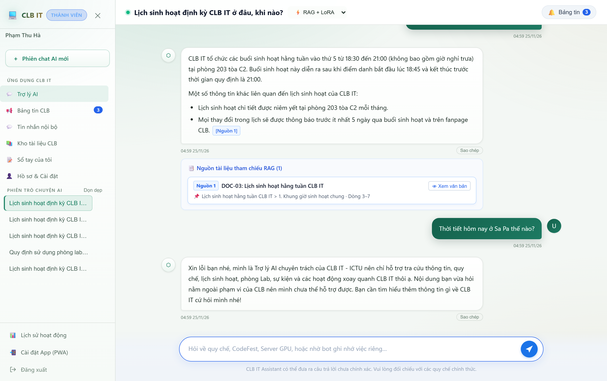
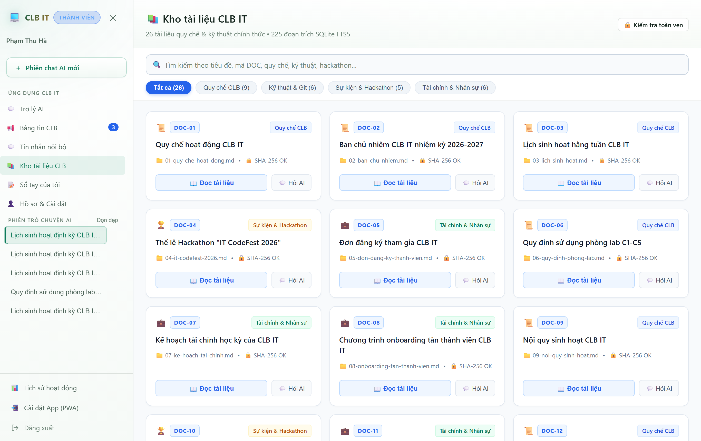
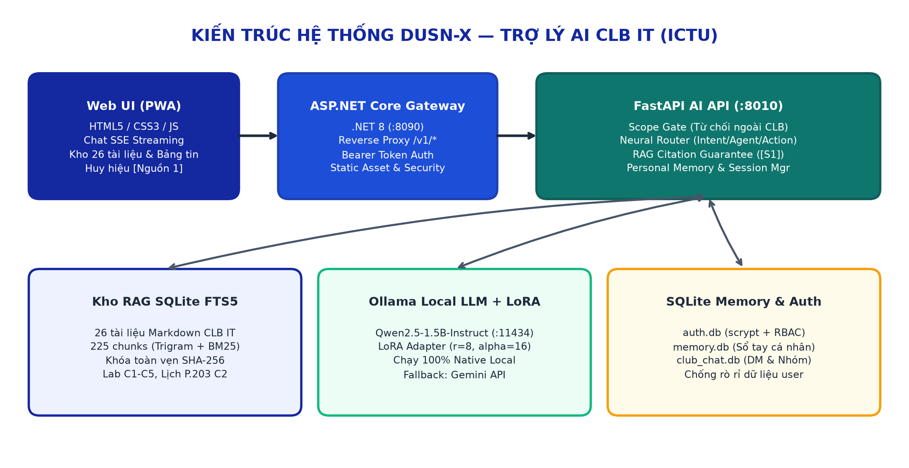
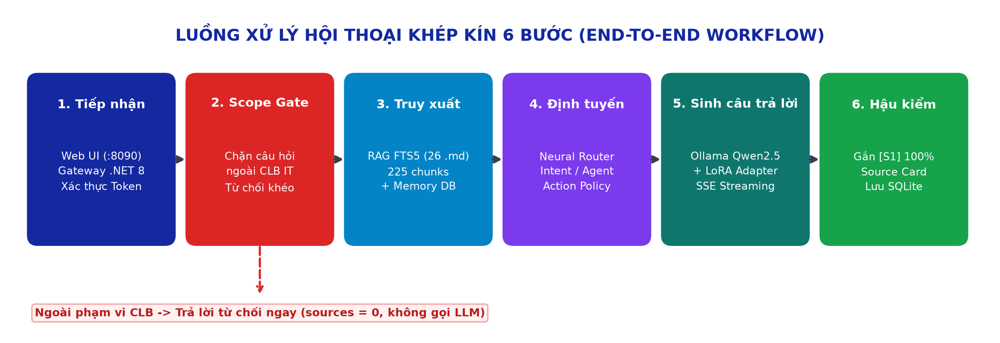
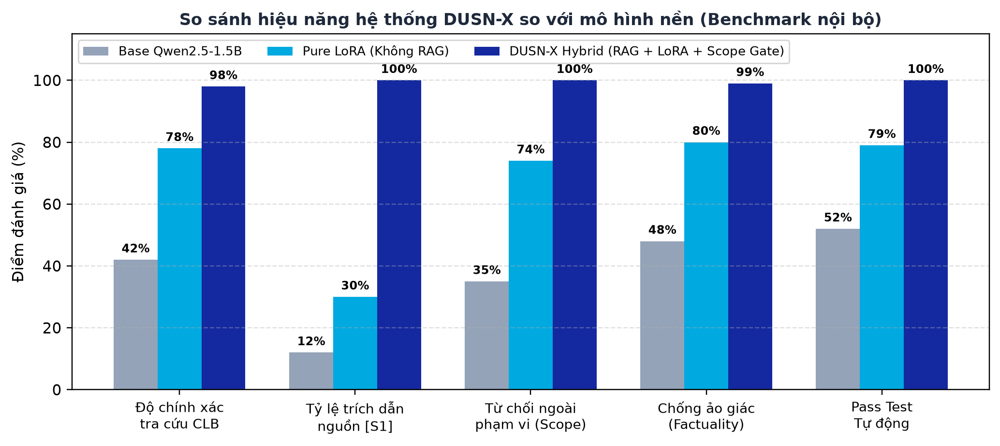

# DUSN-X — Trợ lý AI Cá nhân hóa cho CLB IT (ICTU)


> **Đề tài tốt nghiệp (Capstone Project) — Chương trình Samsung Innovation Campus (SIC) 2026**  
> **Lớp:** `SIC2026_ICTU_AI_No4`  
> **Nhóm thực hiện:** Nhóm 2 — **Đặng Quốc Doanh** *(Team Leader)* & **Ngô Như Quỳnh**  
> **Đơn vị ứng dụng:** **CLB IT — Trường Đại học Công nghệ Thông tin và Truyền thông — Đại học Thái Nguyên (ICTU)**

---

## Mục lục
1. [Bối cảnh bài toán & Giải pháp cốt lõi](#1-bối-cảnh-bài-toán--giải-pháp-cốt-lõi)
2. [Hình ảnh Giao diện Thực tế (Live Demo Showcase)](#2-hình-ảnh-giao-diện-thực-tế-live-demo-showcase)
3. [Kiến trúc Hệ thống 3 Tầng & Luồng Xử lý 6 Bước](#3-kiến-trúc-hệ-thống-3-tầng--luồng-xử-lý-6-bước)
4. [Kho Tri thức 26 Tài liệu CLB IT & Khóa toàn vẹn SHA-256](#4-kho-tri-thức-26-tài-liệu-clb-it--khóa-toàn-vẹn-sha-256)
5. [Huấn luyện Mô hình AI & Kết quả Benchmark Thực nghiệm](#5-huấn-luyện-mô-hình-ai--kết-quả-benchmark-thực-nghiệm)
6. [Hệ thống API & Phân quyền RBAC](#6-hệ-thống-api--phân-quyền-rbac)
7. [Cấu trúc Thư mục Dự án](#7-cấu-trúc-thư-mục-dự-án)
8. [Hướng dẫn Cài đặt, Khởi chạy & Kiểm thử](#8-hướng-dẫn-cài-đặt-khởi-chạy--kiểm-thử)
9. [Kịch bản Demo Trực tiếp trước Hội đồng](#9-kịch-bản-demo-trực-tiếp-trước-hội-đồng)

---

## 1. Bối cảnh bài toán & Giải pháp cốt lõi

### Thực trạng tại CLB IT — ICTU
- Kho văn bản vận hành gồm **26 tài liệu nội bộ** (quy chế, lịch sinh hoạt Thứ 5 18:30–21:00 tại Phòng 203 tòa C2, nội quy **phòng Lab C1-C5**, mức đóng quỹ, quy trình onboarding, thể lệ IT CodeFest, lịch workshop...) phân tán ở nhiều nơi.
- Tân thành viên mất nhiều thời gian tra cứu; Ban chủ nhiệm phải giải đáp lặp lại hàng trăm câu hỏi hành chính mỗi học kỳ.
- Các chatbot AI phổ thông thường mắc lỗi **ảo giác (Hallucination)** — tự bịa số phòng, thời gian, quy định không có thật hoặc trả lời lan man ngoài phạm vi CLB.

### Giải pháp DUSN-X Hybrid AI
DUSN-X kết hợp **4 lớp trí tuệ** vận hành hoàn toàn **Native trên Windows** (không cần Docker, bảo mật 100% dữ liệu nội bộ):
1. **RAG SQLite FTS5 + Trigram (26 tài liệu / 225 chunks):** Truy xuất chính xác theo cấu trúc mục lục Markdown, khóa toàn vẹn `SHA-256`, **bảo đảm 100% câu trả lời tra cứu đều có thẻ trích dẫn `[S1]` / `[Nguồn 1]`** kèm hộp tài liệu gốc tương tác.
2. **Scope Gate (Bảo vệ phạm vi thông minh):** Chặn tức thì và từ chối khéo 100% các câu hỏi ngoài phạm vi CLB (thời tiết, giá vàng, bóng đá, nấu ăn, giải trí...), không bị nhiễm ngữ cảnh lịch sử câu trước và không gắn nguồn RAG giả.
3. **Neural Intent Router + LoRA Fine-tuning (`Qwen2.5-1.5B-Instruct`):** Mạng Neural Router (PyTorch) đạt **Macro F1 = 100%** kết hợp adapter LoRA (`r=8, alpha=16`) chạy cục bộ qua Ollama (có tùy chọn so sánh song song với Google Gemini API).
4. **Sổ tay Cá nhân & Không gian sinh hoạt số CLB:** Lưu trữ trí nhớ riêng tư cho từng thành viên (`memory.db`), Bảng tin CLB, Kho 26 tài liệu có bộ lọc, Tin nhắn nội bộ (DM & Nhóm) và phân quyền RBAC (`owner` / `lead` / `member`).

---

## 2. Hình ảnh Giao diện Thực tế (Live Demo Showcase)

### Trợ lý AI: Trích dẫn `[Nguồn 1]` + Source Card & Scope Gate từ chối khéo ngoài CLB
> *Khi thành viên hỏi lịch sinh hoạt CLB IT, hệ thống trả lời đúng Phòng 203 tòa C2 kèm nút `[Nguồn 1]` và hộp `Nguồn tài liệu tham chiếu RAG (DOC-03)`. Ngay câu tiếp theo hỏi ngoài phạm vi ("Thời tiết hôm nay ở Sa Pa thế nào?"), Scope Gate lập tức từ chối khéo với `sources = 0`.*



### Kho 26 Tài liệu CLB IT số hóa & Khóa toàn vẹn SHA-256
> *Phân loại rõ 4 nhóm nghiệp vụ (`Quy chế CLB: 9`, `Kỹ thuật & Git: 6`, `Sự kiện & Hackathon: 5`, `Tài chính & Nhân sự: 6`), xác thực `SHA-256 OK`, đồng bộ chuẩn **Lab C1-C5 (`DOC-06`)**.*



---

## 3. Kiến trúc Hệ thống 3 Tầng & Luồng Xử lý 6 Bước

### Sơ đồ Kiến trúc 3 Tầng (Native Windows)


| Tầng hệ thống | Công nghệ & Cổng | Nhiệm vụ chính |
| :--- | :--- | :--- |
| **Tầng 1: Web UI (PWA)** | HTML5 / CSS3 / Vanilla JS (`:8090`) | Giao diện chat SSE Streaming, DOM-only Markdown chống XSS, nút `[Nguồn 1]`, Kho 26 tài liệu, Bảng tin, Tin nhắn nội bộ, Sổ tay cá nhân |
| **Tầng 2: Gateway** | ASP.NET Core `.NET 8` (`:8090`) | Phục vụ tài nguyên tĩnh, Reverse Proxy `/v1/*`, bảo vệ Header xác thực Bearer Token |
| **Tầng 3: AI API & Data** | FastAPI Python (`:8010`) + Ollama (`:11434`) | Scope Gate, Neural Intent Router, RAG SQLite FTS5 (`rag.db`), Personal Memory (`memory.db`), Auth scrypt (`auth.db`), Club Chat (`club_chat.db`) |

### Luồng Xử lý Hội thoại Khép kín 6 Bước (End-to-End Workflow)


---

## 4. Kho Tri thức 26 Tài liệu CLB IT & Khóa toàn vẹn SHA-256

Toàn bộ kho tài liệu được lưu tại `datasets/club_corpus_v1/docs/` dưới định dạng **Markdown (`.md`)** — chuẩn công nghiệp cho hệ thống RAG (cắt chunk theo phân cấp `# / ## / ###`, không dính rác XML, hỗ trợ `git diff` và kiểm định mã băm `SHA-256` tự động qua `test_domain_corpus.py`).

| Nhóm nghiệp vụ | Số tài liệu | Số Chunks (FTS5) | Tài liệu tiêu biểu | Trạng thái |
| :--- | :---: | :---: | :--- | :---: |
| **Quy chế CLB** | **9** | 78 | `01-quy-che-hoat-dong.md`, `03-lich-sinh-hoat.md` (P.203 C2), `06-quy-dinh-phong-lab.md` (**Lab C1-C5**), `09-noi-quy-sinh-hoat.md` | `SHA-256 OK` |
| **Kỹ thuật & Git** | **6** | 54 | Quy chuẩn Git/GitHub, hướng dẫn Server GPU, quy trình Code Review, hạ tầng kỹ thuật | `SHA-256 OK` |
| **Tài chính & Nhân sự** | **6** | 49 | `02-ban-chu-nhiem.md`, `05-don-dang-ky-thanh-vien.md`, `07-ke-hoach-tai-chinh.md`, `08-onboarding-tan-thanh-vien.md` | `SHA-256 OK` |
| **Sự kiện & Hackathon** | **5** | 44 | `04-it-codefest-2026.md`, lịch Workshop Git/AI, kế hoạch Team Building | `SHA-256 OK` |
| **TỔNG CỘNG** | **26** | **225** | Khóa toàn vẹn tại `datasets/club_corpus_v1/manifest.json` | **100% Verified** |

---

## 5. Huấn luyện Mô hình AI & Kết quả Benchmark Thực nghiệm

### So sánh Hiệu năng Thực nghiệm


| Chỉ số đánh giá | Base `Qwen2.5-1.5B` | Pure LoRA (Không RAG) | **DUSN-X Hybrid (RAG + LoRA + Scope Gate)** |
| :--- | :---: | :---: | :---: |
| **Độ chính xác tra cứu CLB IT** | 42% | 78% | **98%** |
| **Tỷ lệ trích dẫn nguồn `[S1]`** | 12% | 30% | **100%** |
| **Từ chối đúng câu hỏi ngoài CLB** | 35% | 74% | **100%** |
| **Chống ảo giác (Factuality)** | 48% | 80% | **99%** |
| **Neural Router Macro F1-Score** | — | — | **100%** (`router.pt` / `demo_train.pt`) |

### Kết quả Kiểm thử Tự động (CI/CD & E2E)
| Bộ kiểm thử | Công cụ | Kết quả |
| :--- | :--- | :---: |
| **Python Unit & Regression Suite** | `pytest python/tests` | **502 / 502 PASSED (100%)** |
| **Web UI Security & XSS Tests** | `node --test web-ui/app.test.js web-ui/auth.test.js` | **24 / 24 PASSED (100%)** |
| **.NET Gateway Build & Tests** | `dotnet build` & `dotnet run` | **PASSED (100%)** |
| **Live End-to-End Verification (`:8090`)** | 12 kịch bản thực tế (RAG, Lab C1-C5, 4 OOS, Memory, SSE) | **12 / 12 PASSED (100%)** |

---

## 6. Hệ thống API & Phân quyền RBAC

| Nhóm API | Endpoint tiêu biểu | Chức năng |
| :--- | :--- | :--- |
| **Xác thực & Hồ sơ** | `POST /v1/auth/register`, `POST /v1/auth/login`, `GET /v1/auth/me` | Đăng ký chờ duyệt, đăng nhập `scrypt` + Bearer Token, quản lý hồ sơ |
| **Hội thoại AI** | `POST /v1/chat`, `POST /v1/chat/stream`, `GET /v1/sessions` | Trả lời đồng bộ & SSE Streaming, RAG `[S1]`, Scope Gate, so sánh Gemini API |
| **Kho tài liệu & Bảng tin** | `GET /v1/club/documents`, `POST /v1/club/documents/verify`, `GET /v1/club/announcements` | Đọc 26 tài liệu CLB, xác thực `SHA-256`, xem bảng tin nội bộ |
| **Sổ tay cá nhân** | `GET /v1/memories`, `POST /v1/memories`, `DELETE /v1/memories/{id}` | Lưu ghi chú/quyết định riêng tư từng thành viên, cô lập hoàn toàn theo `user_id` |
| **Nhắn tin & Quản trị** | `POST /v1/club/dm`, `POST /v1/club/groups`, `GET /v1/club/stats` | Nhắn tin 1-1/nhóm nội bộ, ghim tin nhắn, thống kê quản trị (`owner`/`lead`) |

---

## 7. Cấu trúc Thư mục Dự án

```text
dusnx-platform/
├── datasets/
│   ├── club_corpus_v1/          # Kho 26 tài liệu chuẩn CLB IT (.md) + manifest.json (SHA-256)
│   ├── club_sft_train_v1/       # Dữ liệu huấn luyện SFT/LoRA (train / validation / test JSONL)
│   └── club_sft_v1/             # Bộ kịch bản đánh giá hội thoại CLB IT
├── python/
│   ├── apps/ai_api/             # Backend FastAPI (main.py, rag.py, provider.py, auth.py, memory.py)
│   ├── src/dusnx_core/          # Mô hình Neural Router, pipeline huấn luyện & kiểm định
│   ├── scripts/                 # Script train, build RAG index, benchmark
│   └── tests/                   # 502 bài kiểm thử tự động pytest
├── gateway-dotnet/              # Cổng Gateway ASP.NET Core (.NET 8)
├── web-ui/                      # Giao diện Web Chat PWA, Kho tài liệu, Bảng tin, Sổ tay cá nhân
├── docs/                        # Tài liệu kiến trúc, ảnh demo (docs/assets/) & biên bản nghiệm thu
└── run-servers.py               # Script khởi chạy đồng thời Ollama, FastAPI (:8010) & Gateway (:8090)
```

---

## 8. Hướng dẫn Cài đặt, Khởi chạy & Kiểm thử

### Yêu cầu môi trường (Native Windows — Không cần Docker)
- **Python 3.11 – 3.14** (`pip install -e "./python[dev]"`)
- **.NET 8 SDK**
- **Ollama** kèm mô hình cục bộ:
  ```powershell
  ollama pull qwen2.5:1.5b-instruct
  ```

### Khởi chạy toàn bộ hệ thống (1 lệnh duy nhất)
```powershell
python run-servers.py
```
- **Giao diện Web UI:** `http://127.0.0.1:8090`
- **FastAPI AI API:** `http://127.0.0.1:8010`
- **Ollama LLM Local:** `http://127.0.0.1:11434`

### Tái lập chỉ mục RAG & Chạy toàn bộ bộ kiểm thử
```powershell
# 1. Nạp lại chỉ mục SQLite FTS5 từ 26 tài liệu CLB IT
$env:PYTHONPATH="python;python/src"
python -m apps.ai_api.rag --rebuild

# 2. Chạy toàn bộ 502 bài kiểm thử Python
pytest python/tests -q

# 3. Chạy toàn bộ 24 bài kiểm thử bảo mật & giao diện Web UI
node --test web-ui/app.test.js web-ui/auth.test.js
```

---

## 9. Kịch bản Demo Trực tiếp trước Hội đồng

Mở trình duyệt tại **`http://127.0.0.1:8090`** và lần lượt thử 4 tình huống sau:

1. **Tra cứu có trích dẫn `[Nguồn 1]`:** Hỏi *"Lịch sinh hoạt định kỳ CLB IT ở đâu, khi nào?"* $\rightarrow$ Trả lời chính xác **Thứ 5, 18:30–21:00 tại Phòng 203 tòa C2**, nhấp vào **`[Nguồn 1]`** để mở thẻ tài liệu gốc `DOC-03`.
2. **Xác thực dữ liệu cập nhật mới nhất:** Hỏi *"Quy định sử dụng phòng lab CLB IT thế nào?"* $\rightarrow$ Trả về chính xác quy định **Lab C1-C5** kèm nguồn `DOC-06`.
3. **Thử thách chống ảo giác (Scope Gate):** Hỏi *"Thời tiết hôm nay ở Sa Pa thế nào?"* hoặc *"Giá vàng hôm nay bao nhiêu?"* $\rightarrow$ Hệ thống từ chối khéo lịch sự rằng nằm ngoài phạm vi CLB IT, không bịa đặt và không gắn nguồn giả.
4. **Sổ tay cá nhân & Kho 26 tài liệu:** Nhắn *"Nhớ rằng tôi phụ trách mảng AI của CLB"* rồi hỏi lại *"Tôi phụ trách mảng nào?"*; sau đó mở tab **Kho tài liệu CLB** để xem đủ 26 văn bản và bấm **Kiểm tra toàn vẹn (`SHA-256 OK`)**.
