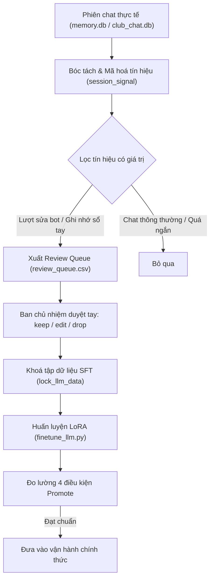

# QUY CHẾ ĐÀO TẠO & KIỂM CHỨNG LORA — CHATBOT CÁ NHÂN HOÁ CLB IT

> Áp dụng cho: Hệ thống Trợ lý AI cá nhân hoá CLB IT (Nhánh `club-assistant` / `main`).  
> Phiên bản: 2.0 — Tháng 11/2026.  
> Căn cứ thiết kế: Đáp ứng yêu cầu chuẩn đào tạo: **Áp dụng LoRA**, **Mã hoá tín hiệu**, **Lấy quá trình làm việc cho vào LoRA**, **Quy chế đào tạo & Huấn luyện lại**, **Tập trung vào 1 dữ liệu**, **Lưu trước 10–20 văn bản**, **Kiến trúc 2 App (RAG & LoRA)**.

---

## 1. Nguyên tắc cốt lõi: Phân định RAG và LoRA

| Thành phần | Đảm nhận | Cơ chế hoạt động | Chống bịa đặt (Anti-hallucination) |
|---|---|---|---|
| **RAG (App A)** | **Sự thật & Tri thức** | Tra cứu trên **18 văn bản** nội quy, điều lệ, ban bệ CLB IT bằng SQLite FTS5 (182 chunks). | **Bắt buộc trích dẫn nguồn** `[S1]`, `[S2]`. Câu hỏi ngoài phạm vi 18 văn bản bị **từ chối ngay lập tức**, không được đoán mò. |
| **LoRA (App B)** | **Hành vi & Quy trình** | Qwen2.5-0.5B-Instruct / 1.5B kết hợp PEFT LoRA ($r=8, \alpha=16$). | Học **cách ứng xử**: xưng hô theo vai trò (Chủ nhiệm, Phó chủ nhiệm, Trưởng ban, Thành viên), hỏi lại khi thiếu dữ kiện, xác nhận trước khi ghi nhớ sổ tay cá nhân. |
| **Hybrid (Kết hợp)** | **Trợ lý toàn diện** | LoRA định hình phong cách phản hồi + RAG cung cấp dữ kiện xác thực. | Vừa có phong cách cá nhân hóa vừa có căn cứ trích dẫn chính xác. |

> [!IMPORTANT]
> **Quy tắc vàng:** Không huấn luyện tri thức, số liệu, mã phòng hay quy định vào trọng số LoRA. Dữ liệu tra cứu luôn thuộc về RAG để khi CLB thay đổi quy chế chỉ cần cập nhật kho văn bản mà không phải train lại model.

---

## 2. Bảy nguyên tắc bất biến trong Đào tạo (Training Invariants)

1. **Sự thật thuộc RAG, Hành vi thuộc LoRA:** Tuyệt đối không nhét runbook hay số liệu vào LoRA.
2. **Không train trên dữ liệu chưa duyệt:** Mọi mẫu vào tập train phải qua cổng duyệt tay của con người (`keep`/`edit`), không dùng dữ liệu `pending`.
3. **Test đóng băng trước khi train:** Bộ câu hỏi test (20 câu) do người viết, khóa mã băm SHA-256 trước khi bắt đầu train; cấm sửa test sau khi thấy kết quả.
4. **Không đo thì không promote:** Candidate LoRA phải được đo đạc đối chiếu với Base Model trên cùng tập test đóng băng.
5. **Không bằng chứng giả:** Không dùng script tự động nâng trạng thái duyệt hoặc tạo log kiểm thử giả.
6. **Mã hoá tín hiệu & Không rò rỉ bí mật:** Dữ liệu chat trước khi vào LoRA phải được lọc bỏ email, mã bí mật, số điện thoại; bóc tách thành tín hiệu tương tác không lưu PII.
7. **Mọi kết quả phải truy vết được:** Mỗi đợt huấn luyện gắn liền với commit git, mã SHA-256 của tập dữ liệu và siêu tham số cố định.

---

## 3. Mã hoá tín hiệu & Quá trình làm việc vào LoRA

Quy trình khép kín đưa tương tác thực tế của thành viên vào đợt huấn luyện lại:

* **Mã hoá tín hiệu:** Mỗi phiên làm việc được mã hoá thành một bản ghi định lượng:
  - `turn_count`: Số lượt trao đổi.
  - `intents`: Phân loại ý định (`question`, `instruction`, `memory_write`, `correction`).
  - `outcomes`: Kết quả (`answered`, `refused`, `not_applicable`).
  - `has_correction`: Người dùng có sửa câu trả lời của bot không.
  - `has_memory_write`: Có yêu cầu ghi vào sổ tay không.
* **Bộ lọc ứng viên SFT:** Lệnh `python python/scripts/export_sft_candidates.py --require-signal correction_or_memory` chỉ trích xuất những phiên làm việc có tương tác chỉnh sửa hoặc ghi nhớ để con người duyệt.
* **Hàng đợi duyệt (`review_queue.csv`):** Xuất theo chuẩn CSV RFC 4180 để mở trực tiếp trong Excel / Google Sheets, người duyệt chỉ cần điền `keep` hoặc `edit`.

---

## 4. Kho 10–20 văn bản lưu trước & Khóa Hash

Kho tài liệu CLB IT gồm **18 văn bản chuẩn** tại `datasets/club_corpus_v1/docs/`:
1. `doc-01-dieu-le.md` — Điều lệ và mục đích hoạt động CLB IT.
2. `doc-02-co-cau-to-chuc.md` — Cơ cấu tổ chức: Ban chủ nhiệm, Ban kỹ thuật, Ban truyền thông, Ban sự kiện.
3. `doc-03-quyen-nghia-vu.md` — Quyền lợi và nghĩa vụ của hội viên.
4. `doc-04-tai-chinh.md` — Quy chế tài chính và quỹ sinh hoạt.
5. `doc-05-sinh-hoat-dinh-ky.md` — Lịch sinh hoạt định kỳ (Chiều thứ 7, phòng Lab 402).
6. `doc-06-khen-thuong-ky-luat.md` — Tiêu chí khen thưởng và kỷ luật.
7. `doc-07-tuyen-thanh-vien.md` — Quy trình xét tuyển thành viên mới.
8. `doc-08-quan-ly-thiet-bi.md` — Quy định mượn trả máy tính, thiết bị IoT/server phòng lab.
9. `doc-09-dao-tao-noi-bo.md` — Khung đào tạo chuyên môn lập trình & AI.
10. `doc-10-cuoc-thi-hackathon.md` — Quy chế tổ chức cuộc thi thường niên IT CodeFest.
11. `doc-11-hoat-dong-tinh-nguyen.md` — Hoạt động công nghệ vì cộng đồng.
12. `doc-12-an-toan-thong-tin.md` — Quy định bảo mật dữ liệu và tài khoản nội bộ.
13. `doc-13-truyen-thong.md` — Quy chuẩn phát ngôn và bài đăng fanpage.
14. `doc-14-hop-tac-doanh-nghiep.md` — Chính sách tham quan doanh nghiệp và thực tập.
15. `doc-15-nghi-phep.md` — Quy trình xin nghỉ sinh hoạt và bảo lưu tư cách thành viên.
16. `doc-16-ban-giao.md` — Quy chế bàn giao công việc khi chuyển giao nhiệm kỳ.
17. `doc-17-giai-quyet-khieu-nai.md` — Quy trình tiếp nhận và xử lý khiếu nại.
18. `doc-18-lien-he.md` — Danh bạ liên hệ Ban chủ nhiệm và các kênh liên lạc.

* **Khóa toàn vẹn bằng SHA-256:** File `manifest.json` ghi nhận mã SHA-256 của từng file. Nếu bất kỳ file nào bị sửa đổi dù chỉ 1 ký tự, hệ thống kiểm thử `test_domain_corpus.py` sẽ lập tức báo lỗi.

---

## 5. Thử nghiệm so sánh 2 APP (RAG vs LoRA)

Trên Web UI, người dùng có thể chọn ngay trên thanh công cụ:

| Kịch bản thử nghiệm | App A (Thuần RAG) | App B (Thuần LoRA) | Chế độ Hybrid (Kết hợp) |
|---|---|---|---|
| *"Lịch sinh hoạt CLB vào thứ mấy, ở đâu?"* | Trả lời chính xác: Chiều thứ 7 tại Lab 402, trích dẫn `[S1]`. | Báo cần tra cứu tài liệu quy chế để có thông tin chính xác. | Trả lời đầy đủ, xưng hô theo vai trò và trích nguồn `[S1]`. |
| *"CLB có mở lớp dạy bơi lội không?"* | Từ chối ngay: Kho tài liệu không có thông tin này (Anti-hallucination). | Lịch sự phản hồi câu hỏi nằm ngoài phạm vi hoạt động chuyên môn của CLB IT. | Lịch sự từ chối và hướng dẫn liên hệ Ban chủ nhiệm. |
| *"Nhớ giúp tôi là tôi phụ trách mảng Backend nhé."* | Thông báo chức năng ghi nhớ thuộc về trợ lý cá nhân, không tra cứu RAG. | Hỏi xác nhận và lưu vào sổ tay cá nhân (`memory.db`). | Xác nhận và lưu vào sổ tay cá nhân của thành viên. |
| *"Viết lại thông báo này cho trang trọng hơn."* | Giữ nguyên văn bản, không ưu tiên xử lý phong cách. | Viết lại mượt mà theo đúng phong cách quy chuẩn của CLB. | Viết lại mượt mà, đúng chuẩn văn phong CLB. |
