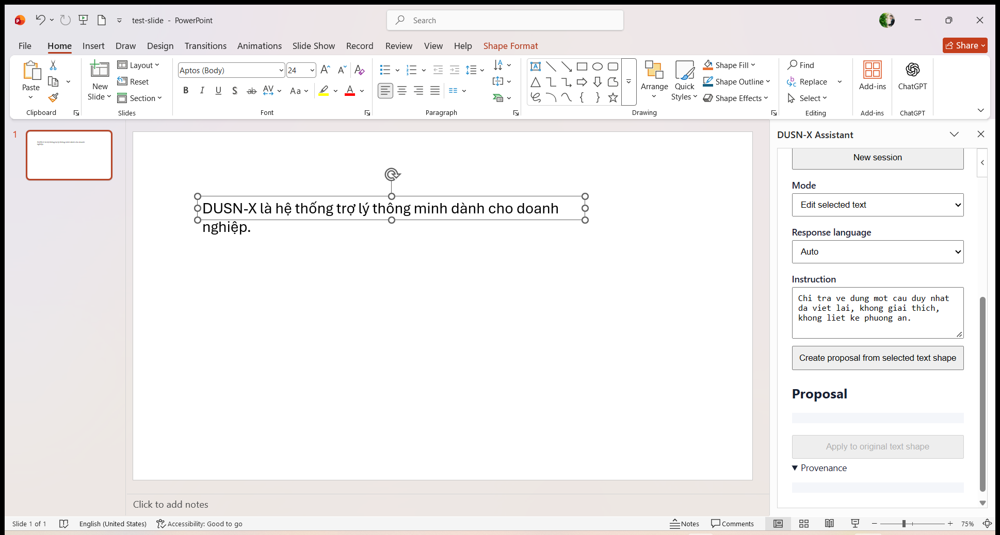
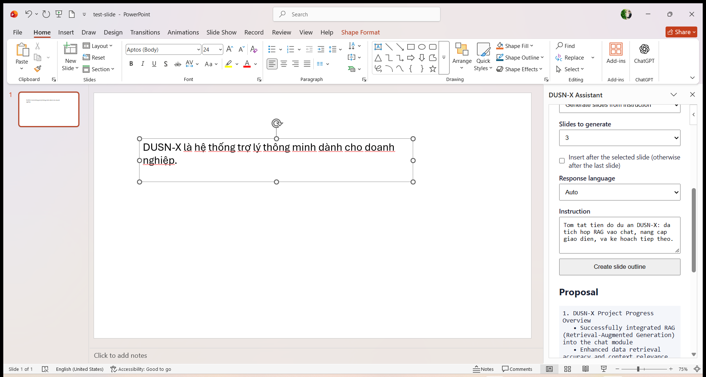
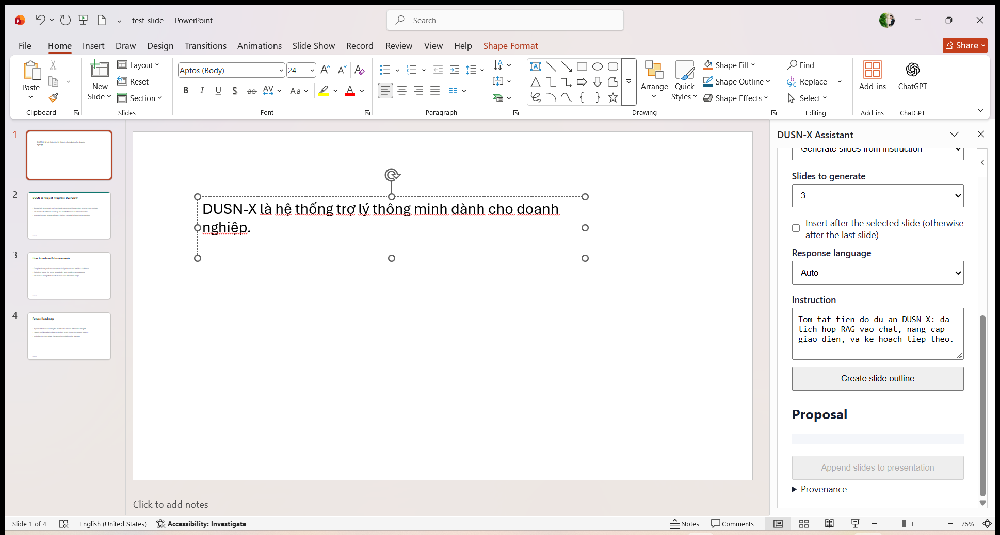
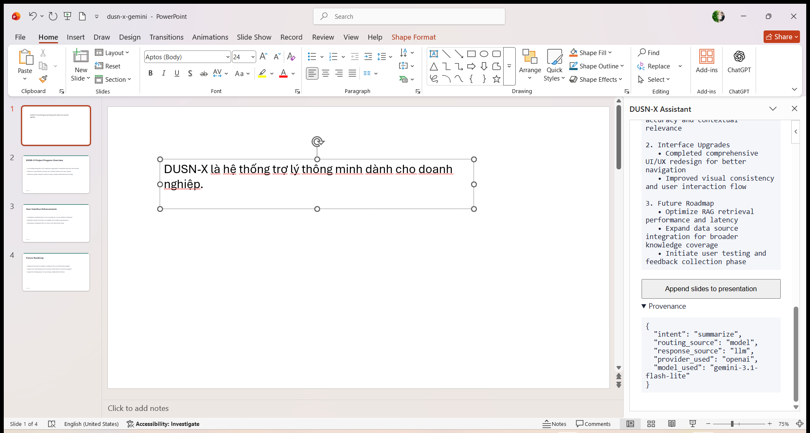

# PowerPoint Add-in Desktop evidence — 2026-11-09

Bằng chứng chạy **PowerPoint Desktop thật** với task pane Office.js sideload, Gateway local và
provider ngoài Gemini. Tài khoản là user tổng hợp `geminidesktop1`; deck là file test tổng hợp.
Không có token, mật khẩu, cookie, dữ liệu người dùng thật hay secret nào trong thư mục này.

## Môi trường

| Thành phần | Giá trị |
|---|---|
| Ứng dụng | Microsoft PowerPoint, `16.0` build `20527`, platform `PC` |
| Task pane | `https://localhost:3001/taskpane.html` (Office tự thêm `_host_Info`) |
| Manifest | sideload theo user qua `HKCU\Software\Microsoft\Office\16.0\WEF\Developer`, GUID `8fbb6156-fd66-4d28-8b54-4f44ec970001` |
| HTTPS server | `word-addin/dev-server.js`: same-origin, CSP, `no-store`, proxy `/v1/*` về Gateway loopback |
| Gateway / AI API | `http://127.0.0.1:8080` / `http://127.0.0.1:8000` |
| Provider | Gemini qua endpoint OpenAI-compatible, model `gemini-3.1-flash-lite`, fallback `ollama` |

Số liệu gốc: [`real-powerpoint-evidence.json`](real-powerpoint-evidence.json).

## Kết quả

### 1. Chế độ sửa text đang chọn



Đăng nhập, tạo session `PowerPoint`, chọn shape text trên slide 1 và bấm
**Create proposal from selected text shape**. Task pane hiện proposal và trạng thái
`Review the proposal, then Apply to the original selected text shape.`; slide chưa bị ghi.
Bấm **Apply to original text shape**: text của shape được thay bằng proposal, proposal bị xóa
và nút Apply khóa lại.

Provenance của lượt này (chụp tại [`powerpoint-desktop-provenance-edit.png`](powerpoint-desktop-provenance-edit.png)):

```json
{
  "intent": "recommendation",
  "routing_source": "model",
  "response_source": "llm",
  "provider_used": "openai",
  "model_used": "gemini-3.1-flash-lite"
}
```

### 2. Chế độ sinh slide: tạo outline



Mode **Generate slides from instruction**, số slide `3`, instruction tóm tắt tiến độ dự án.
Model trả outline 3 slide; task pane hiện
`Review 3 slide(s), then insert them after slide 1.` và giữ nguyên presentation (1 slide).

### 3. Apply: chèn đúng 3 slide, đúng thứ tự



Bấm **Append slides to presentation**: trạng thái `Inserted 3 slide(s) after slide 1.`,
presentation thành 4 slide, hiển thị trong thumbnail pane. Kiểm tra lại bằng COM:

| Slide | Title | Footer | Ghi chú |
|---|---|---|---|
| 1 | — (TextBox 1) | — | Nội dung gốc giữ nguyên |
| 2 | DUSN-X Project Progress Overview | `DUSN-X · 2` | 3 bullet từ outline |
| 3 | User Interface Enhancements | `DUSN-X · 3` | 3 bullet từ outline |
| 4 | Future Roadmap | `DUSN-X · 4` | 3 bullet từ outline |

Mỗi slide mới mang đủ shape `DUSN-X Title`, `DUSN-X Body`, `DUSN-X Footer` của template; không
có slide thừa. Deck được lưu thành file mới và đọc lại: SHA-256
`fa2e5125d6da253ca556b9fa425e263a56ca90fbd13a693eefa1ac47ef58e20b`, 41.004 byte, 4 slide.
File `.pptx` chỉ lưu local (artifact test), không commit vào repo.

### 4. Provenance của lượt sinh slide



Outline thứ hai (sau khi deck đã có 4 slide) được tạo chỉ để chụp provenance, **không Apply**;
deck đã lưu vẫn là 4 slide. Provenance:

```json
{
  "intent": "summarize",
  "routing_source": "model",
  "response_source": "llm",
  "provider_used": "openai",
  "model_used": "gemini-3.1-flash-lite"
}
```

## Lỗi thật đã tìm và sửa trong đợt này

Trước khi sửa, **mọi lần Apply ở chế độ sinh slide đều thất bại** trên Desktop thật với
`The target slide no longer exists. Create and review a new outline before Apply.`, dù slide
đích vẫn tồn tại.

- **Nguyên nhân đo được:** host trả `slide.id` đã chứa dấu `#` (id quan sát được:
  `256#3520995159`). Add-in tự nối thêm `#` vào id đích rồi cắt từ `#` đầu tiên, còn lại `256`
  nên không bao giờ khớp với id thật.
- **Sửa:** dùng nguyên id host trả về, so sánh id dạng chuỗi ở mọi chỗ (planned target, lọc slide
  mới, tính số thứ tự footer). Mock host trong test cũng dùng id dạng `2#3520995161` và không
  còn cắt tại `#`.
- **Kiểm chứng:** `node --test powerpoint-addin/taskpane.test.js` → **21/21 pass**, gồm cả ca
  composite-id (có `#`) và numeric-id; sau đó chạy lại toàn bộ luồng trên PowerPoint Desktop
  và Apply thành công như mục 3.

## Kiểm thử tự động đi kèm

- `powerpoint-addin/taskpane.test.js`: 21/21 pass (plan/parse/apply/guard/provenance/id dạng số
  và id chứa `#`).
- Các suite khác của repo được chạy lại ở lượt bàn giao (xem `docs/PROJECT_STATUS_20261107.md`).

## Ghi chú trung thực

- Bằng chứng này chứng minh **tích hợp, guard, chèn template và provenance hoạt động trong
  PowerPoint thật**, không chứng minh chất lượng nội dung do model sinh.
- Proposal edit-mode dùng để chụp provenance sau đó **không Apply**; nội dung proposal thứ hai
  có chứa ký hiệu Markdown `**...**` do model tự thêm — chưa ghi vào shape nào, nhưng cho thấy
  người dùng vẫn phải review trước khi Apply.
- Ảnh chụp từ cửa sổ PowerPoint thật ở 100% (màn hình 1920×1080, DPI 125%); không dùng mock
  hay ảnh dựng.
- Mở task pane: nhấp đúp mục `DUSN-X Assistant` trong flyout **Add-ins**; một lần nhấp chỉ
  highlight.
