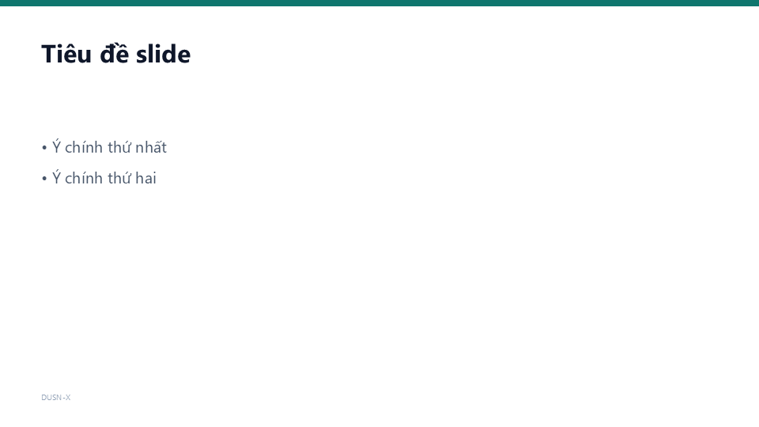
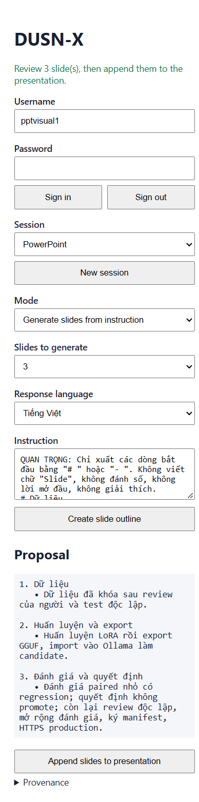
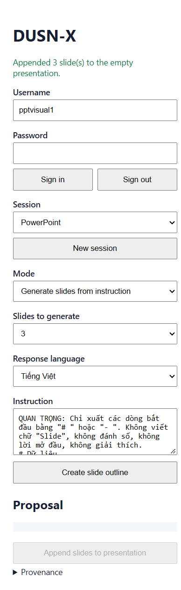
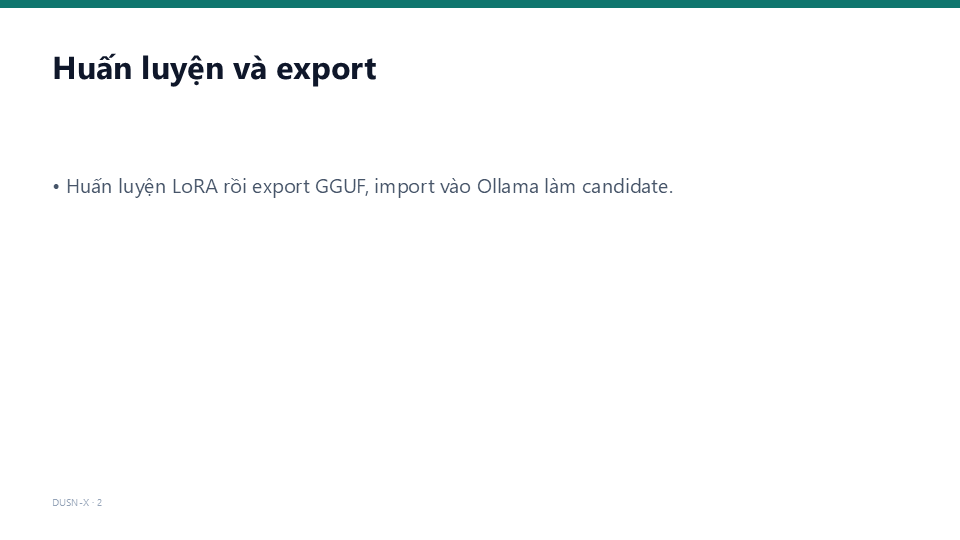
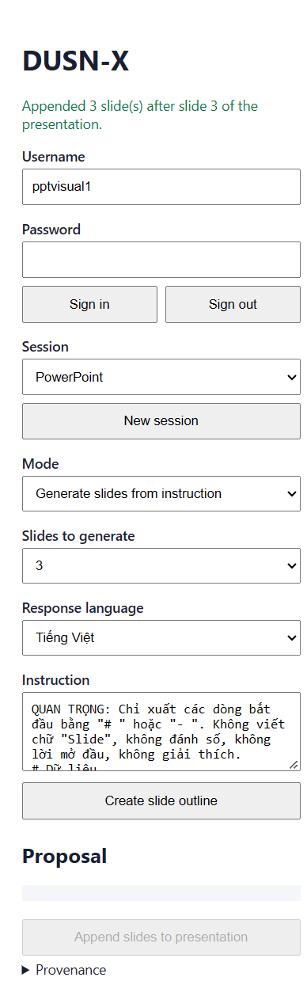
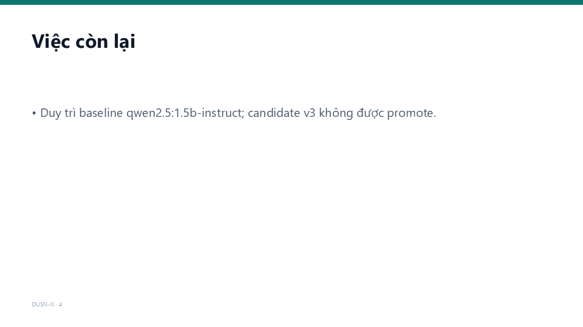
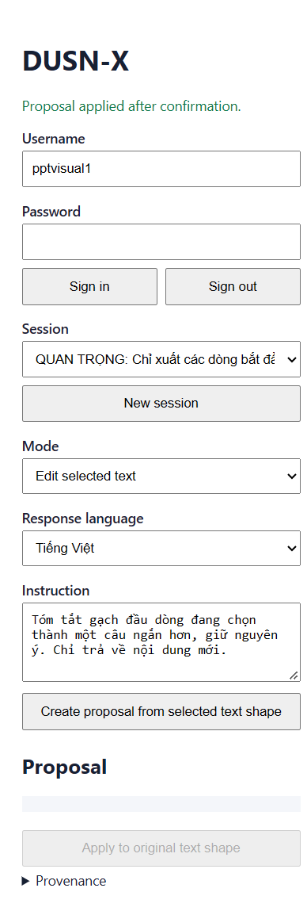

# PowerPoint add-in — chế độ tạo slide từ chỉ dẫn (2026-11-07)

Bằng chứng chạy **PowerPoint Desktop thật** (Office.js task pane) với Gateway local và Ollama,
cho hai chế độ của add-in: sửa nội dung đang chọn tại chỗ và tạo thêm slide theo chỉ dẫn gõ
trong task pane. Tài khoản là user tổng hợp `pptvisual1`; deck là presentation test chưa lưu
(`Presentation1`). Không có token, mật khẩu, cookie hay dữ liệu người dùng thật trong thư mục này.

Số liệu gốc: [`evidence.json`](evidence.json).

## Môi trường

| Thành phần | Giá trị |
|---|---|
| Ứng dụng | Microsoft PowerPoint Desktop, `16.0.20527` (Win32) |
| Task pane | `https://localhost:3001/taskpane.html` qua `word-addin/dev-server.js` same-origin |
| Gateway / AI API | `http://127.0.0.1:8181` / `http://127.0.0.1:8180` |
| Model lúc chạy bằng chứng | `dusnx-vi-v3-20261107` (candidate) |
| Model sau khi kết thúc | `qwen2.5:1.5b-instruct` (baseline, đã khôi phục) |
| Template | `powerpoint-addin/deck-template.pptx`, 960×540 px, 4 shape có tên |

Candidate **không được promote**; nó chỉ được dùng để chạy thử tích hợp. Không có quyết định
promote nào được tạo trong lần chạy này.

## Template

Template một slide với các shape cố định: `DUSN-X Accent` (thanh jade #0F766E),
`DUSN-X Title` (Segoe UI 32 bold), `DUSN-X Body` (Segoe UI 20, bullet `•`) và
`DUSN-X Footer`. Màu được ghi theo BGR của PowerPoint COM; bản đầu bị đảo kênh nên
thanh accent ra màu olive, đã sửa và render lại trước khi chạy bằng chứng.

## 1. Sinh outline và xem trước

Chọn mode **Generate slides from instruction**, số slide `3`, ngôn ngữ `Tiếng Việt`, gõ chỉ dẫn
rồi bấm **Create slide outline**. Pane gọi `/v1/chat`, kiểm tra provenance (`provider_ok`,
`response_source=llm`, `model_used`) rồi hiển thị outline dạng `1. Title` + `• bullet`.
Chưa có slide nào được ghi vào deck ở bước này.

Bộ phân tích outline chấp nhận preamble ngắn, nhãn `# Slide 1 - ...`/`Slide 2:` và tiền tố
`Title:`/`Bullet text:` do model sinh ra; từ chối code fence, JSON và số slide sai. Trong
nhiều lần chạy, model v3 trả về 1/2/4/6 slide hoặc đổi nội dung; pane dừng trước khi ghi và
báo rõ lỗi, không tạo proposal.

## 2. Apply vào deck trống

Deck trống (0 slide). Bấm **Append slides to presentation**: pane tải template same-origin,
chèn đúng 3 slide, điền title/body/footer, xóa proposal và khóa nút Apply.

Kết quả đọc lại bằng Office.js:

| # | Title | Body | Footer |
|---|---|---|---|
| 1 | Dữ liệu | • Dữ liệu đã khóa sau review của người và test độc lập. | DUSN-X · 1 |
| 2 | Huấn luyện và export | • Huấn luyện LoRA rồi export GGUF, import vào Ollama làm candidate. | DUSN-X · 2 |
| 3 | Đánh giá và quyết định | • Đánh giá paired nhỏ có regression; quyết định không promote; còn lại review độc lập, mở rộng đánh giá, ký manifest, HTTPS production. | DUSN-X · 3 |

## 3. Append sau slide đã có (giữ thứ tự)

`insertSlidesFromBase64` mặc định chèn vào **đầu** deck. `insertPlan` chèn ngược từ slide cuối
với `targetSlideId` rồi điền theo thứ tự deck, nên nhóm mới luôn nằm sau slide cuối hiện có.
Lần chạy này dùng một outline đã review được **inject bởi harness** (không gọi model) để kiểm
tra riêng đường Apply: trước 3 slide, sau 6 slide, thứ tự title đúng, footer tuyệt đối `4`, `5`, `6`.

## 4. Sửa nội dung đang chọn tại chỗ

Chọn shape `DUSN-X Body` trên slide 1, chuyển mode **Edit selected text**, gõ chỉ dẫn tóm tắt.
Pane đọc đúng một slide + một shape văn bản, gửi nội dung lên gateway, hiển thị proposal và
provenance; chỉ khi bấm **Apply to original text shape** mới ghi vào shape. Kết quả:
`Dữ liệu đã khóa sau review của người và test độc lập.`, trạng thái
`Proposal applied after confirmation.`, proposal bị xóa.

Các guard thay đổi selection/text/session và rollback khi template thiếu shape được kiểm bằng
unit test (17 test task pane), gồm cả trường hợp Apply lần hai bị từ chối.

## 5. Kiểm thử

| Bộ | Lệnh | Kết quả |
|---|---|---|
| Node add-in + web | `node --test web-ui/app.test.js web-ui/auth.test.js powerpoint-addin/taskpane.test.js word-addin/word-taskpane.test.js word-addin/dev-server.test.js` | 58 passed, 0 failed |
| PowerPoint task pane | `node --test powerpoint-addin/taskpane.test.js` | 17 passed, 0 failed |
| Python | `python -m pytest python/tests -q` | 353 passed, 0 failed |
| Gateway harness | `dotnet run --project gateway-dotnet.tests -c Release --no-build` | 7/7 passed |

## Hạn chế và việc còn lại

- Model v3 (và baseline 1.5b) chưa ổn định với định dạng outline: số slide sai, đôi khi đổi
  từ ngữ hoặc thêm câu mở đầu. Pane coi preview là bước review bắt buộc, không tự Apply.
- Bằng chứng sinh slide dùng candidate; sau khi chụp xong stack đã được khôi phục về
  `qwen2.5:1.5b-instruct`. Không có promote, không có receipt/attestation nào được tạo.
- Ảnh slide là export PNG từ deck test chưa lưu, không phải file `.pptx` bàn giao. Muốn có
  deck bàn giao cần chạy lại với nội dung đã review và lưu file.
- Chưa kiểm tra đồng thời nhiều cửa sổ PowerPoint hoặc undo/redo sau Apply.
