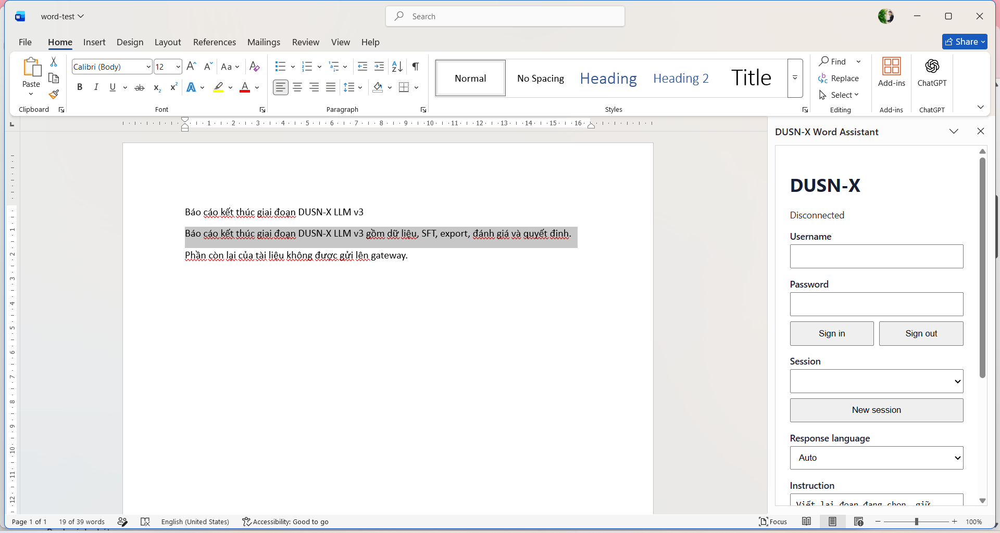
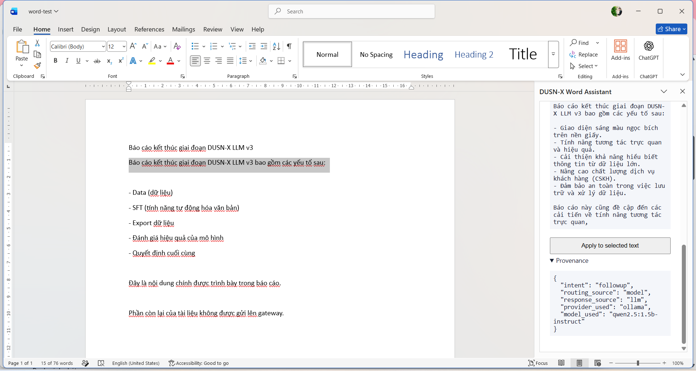
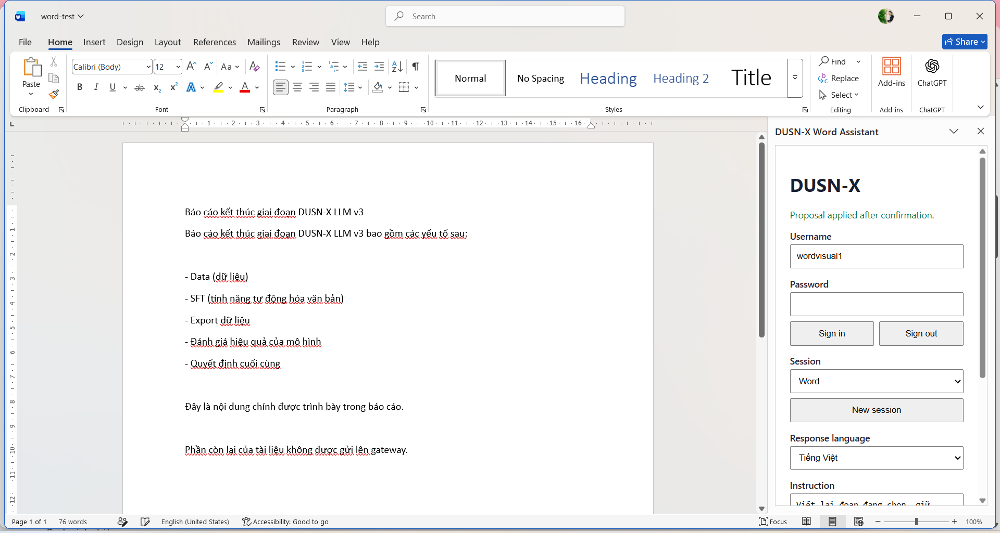
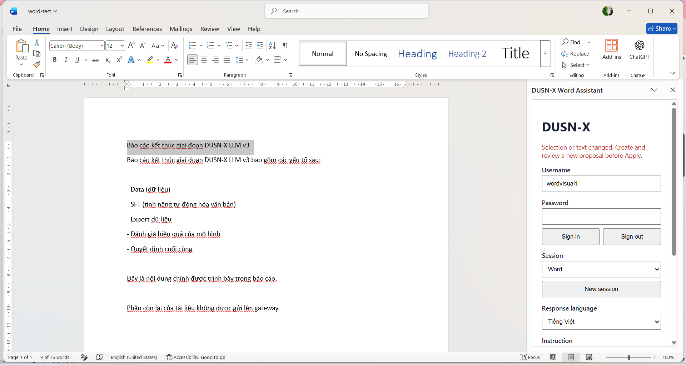
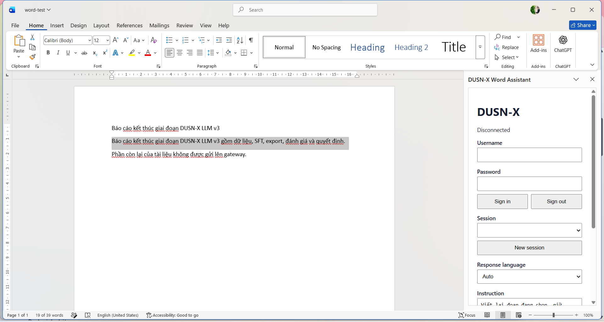
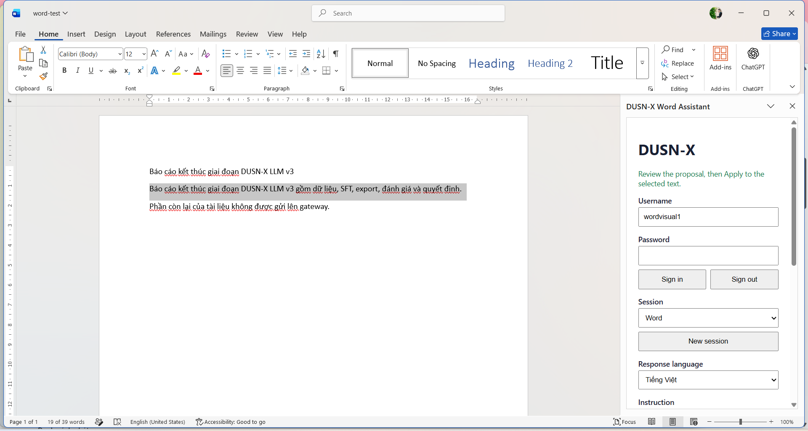
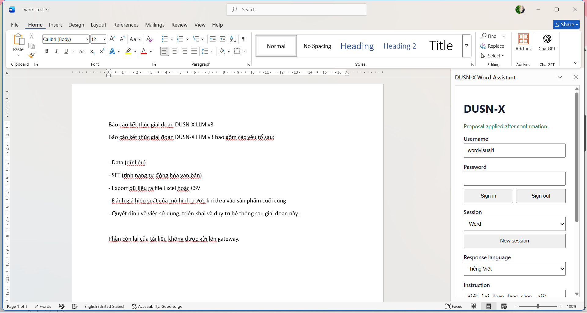
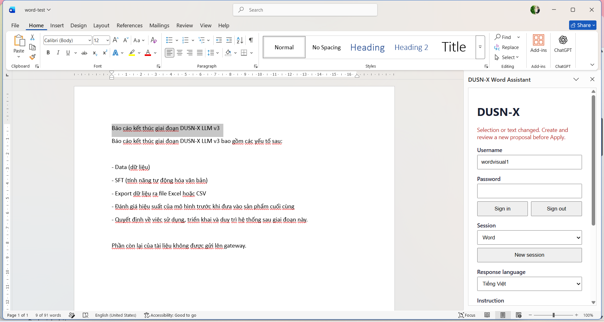

# Word Add-in Desktop evidence — 2026-11-06/07

Bằng chứng chạy **Word Desktop thật** với task pane Office.js sideload, Gateway local và
Ollama. Tài khoản là user tổng hợp `wordvisual1`; tài liệu là file test tổng hợp. Không có
token, mật khẩu, cookie, dữ liệu người dùng thật hay secret nào trong thư mục này.

## Môi trường

| Thành phần | Giá trị |
|---|---|
| Ứng dụng | Microsoft Word, `16.0.20527.20112`, platform `PC` |
| Requirement set | `WordApi 1.1` = true, `WordApi 1.3` = true |
| Task pane | `https://localhost:3001/word-taskpane.html?_host_Info=Word$Win32$16.01$en-US$$$$0` |
| Manifest | sideload theo user qua `HKCU\Software\Microsoft\Office\16.0\WEF\Developer` |
| Gateway | `http://localhost:8181` (local), AI API `8180`, Ollama `qwen2.5:1.5b-instruct` |
| HTTPS server | lần đầu: static server + inject `DUSNX_GATEWAY`; lần hai: `word-addin/dev-server.js` same-origin, CSP, proxy `/v1/*` |

Số liệu gốc: [`real-word-evidence.json`](real-word-evidence.json).

## Kết quả

### 1. Task pane nạp trong Word thật



Word đang mở `word-test.docx`, đoạn đích được chọn, task pane `DUSN-X Word Assistant` dock bên
phải, trạng thái `Disconnected`, form đăng nhập hiển thị.

### 2. Proposal + provenance



Sau khi đăng nhập, tạo session và bấm **Create proposal from selected text**, task pane hiện
proposal và provenance:

```json
{
  "intent": "followup",
  "routing_source": "model",
  "response_source": "llm",
  "provider_used": "ollama",
  "model_used": "qwen2.5:1.5b-instruct"
}
```

Tài liệu chưa bị ghi ở bước này; proposal chỉ nằm trong task pane.

### 3. Apply đúng một lần



Bấm **Apply to selected text**: đoạn đang chọn được thay bằng nội dung proposal, đoạn cuối
`Phần còn lại của tài liệu không được gửi lên gateway.` vẫn còn, trạng thái
`Proposal applied after confirmation.`, proposal bị xóa và nút Apply khóa lại.

File kết quả đã lưu và đọc lại bằng COM/Word: SHA-256
`c923417b7a3a81fc409a65db60eb051c1907988cb0ff24a83d626640aa4d2657`, 17.970 byte,
9 đoạn. Danh sách đoạn nằm trong `real-word-evidence.json` (`saved_document.paragraphs`).
File `.docx` chỉ lưu local (artifact test), không commit vào repo.

### 4. Guard khi selection đổi



Tạo proposal mới trên đoạn đích, sau đó đổi selection sang đoạn tiêu đề rồi bấm Apply. Kết quả:

- Trạng thái: `Selection or text changed. Create and review a new proposal before Apply.`
- Proposal bị xóa, Apply bị khóa.
- Toàn bộ paragraph trước/sau giống nhau (`documentUnchanged: true`), tức không có write.

## Lần chạy lại: dev-server same-origin



Lần chạy thứ hai dùng `word-addin/dev-server.js` trong repo: task pane và `/v1/*` cùng origin
`https://localhost:3001`, không chèn `DUSNX_GATEWAY` vào HTML. Server chỉ phục vụ hai asset,
proxy loopback tới Gateway, trả CSP/`no-store`/`nosniff`; `/manifest.xml` trả `404`.
Task pane vẫn nạp Office.js và gọi API bình thường, tức CSP không chặn host.



Đăng nhập, tạo session `Word`, chọn đoạn 2, tạo proposal: provenance giống lần đầu
(`response_source: "llm"`, `provider_used: "ollama"`, `model_used: "qwen2.5:1.5b-instruct"`),
tài liệu chưa đổi.



Apply đúng một lần, proposal bị xóa, Apply khóa lại; đoạn cuối vẫn còn.



Guard: tạo proposal cho đoạn 2, chuyển selection sang đoạn 1 rồi Apply → từ chối
`Selection or text changed...`, proposal bị xóa, tài liệu không đổi. Một lần thử guard trên
đoạn rỗng chỉ trả `Select text in the document first.` (cũng không ghi), nên kịch bản được lặp
với hai đoạn không rỗng.

File kết quả lần hai: SHA-256
`7ed21baa02486e8735d94aa4556e46c752fe98becaf1cb3173fd0e302ed61d4e`, 18.401 byte, 10 đoạn;
dữ liệu nằm trong `real-word-evidence.json` mục `same_origin_run`. File `.docx` chỉ lưu local.

## Kiểm thử tự động đi kèm

- `word-addin/word-taskpane.test.js`: 15/15 pass (proposal/apply/guard/logout/race/abort/provenance).
- `word-addin/dev-server.test.js`: 7/7 pass (allowlist, Gateway URL, header, CSP, body limit).
- Tổng Node suite: 48/48; .NET Gateway: 7/7; Python: 353/353.
- Mock Office host (không phải Word Desktop) chạy thêm kịch bản memory-answer bị từ chối;
  dữ liệu gốc nằm trong `real-word-evidence.json` mục `simulated_harness`.

## Ghi chú trung thực

- Bằng chứng này chứng minh **tích hợp và guard hoạt động trong Word thật**, không chứng minh
  chất lượng văn bản của model. `qwen2.5:1.5b-instruct` viết lại chưa ổn định: ở lần chạy này
  model thêm bullet và suy diễn ngoài đoạn gốc. Người dùng vẫn phải review proposal; production
  nên dùng model lớn hơn.
- Một proposal sau đó (không Apply) được dùng để chụp provenance; nội dung proposal thứ hai
  cũng do model sinh và không được ghi vào tài liệu.
- Ảnh chụp màn hình lấy từ cửa sổ Word thật ở 100% (màn hình 1920×1080, DPI 125%). Không dùng
  mock hay ảnh dựng cho các ảnh trong thư mục này.
- Quá trình mở task pane cần nhấp đúp mục add-in trong flyout **Add-ins → Developer Add-ins**;
  một lần nhấp chỉ highlight.
