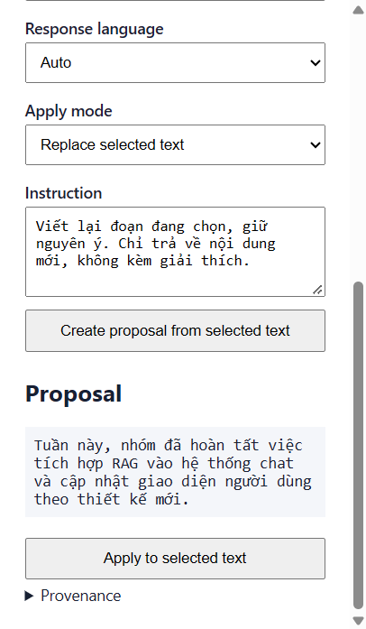
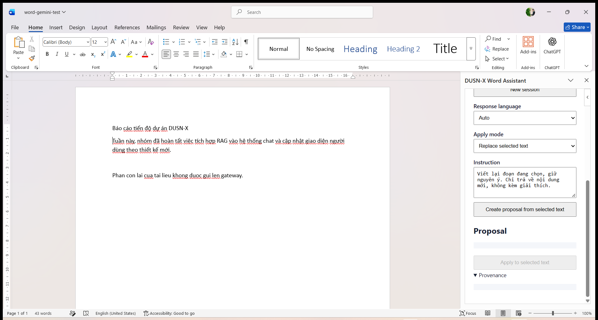
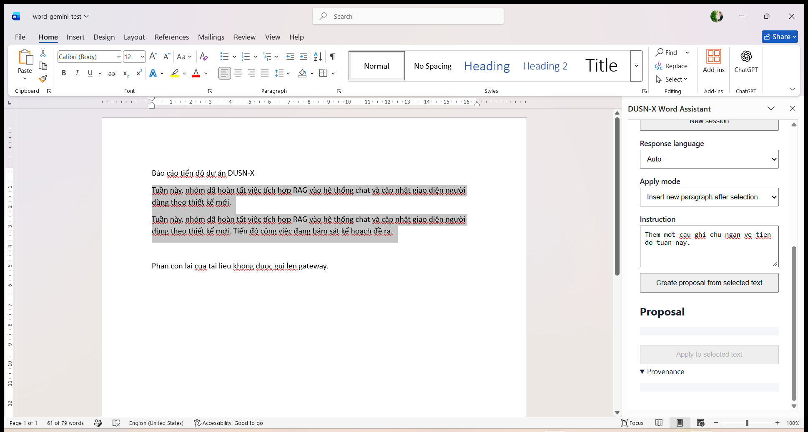
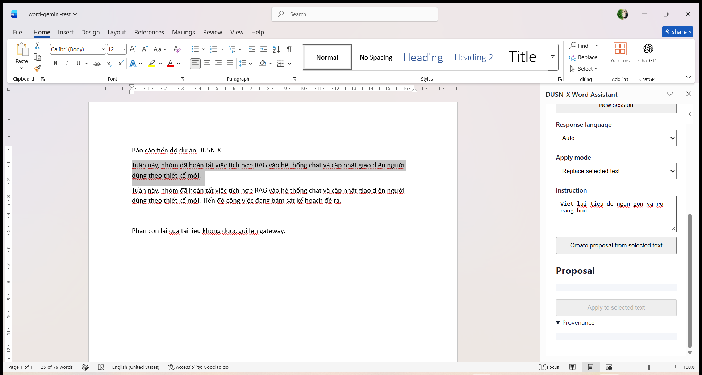
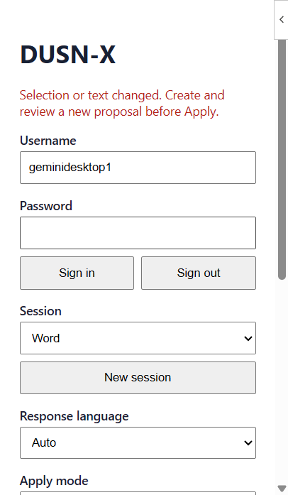
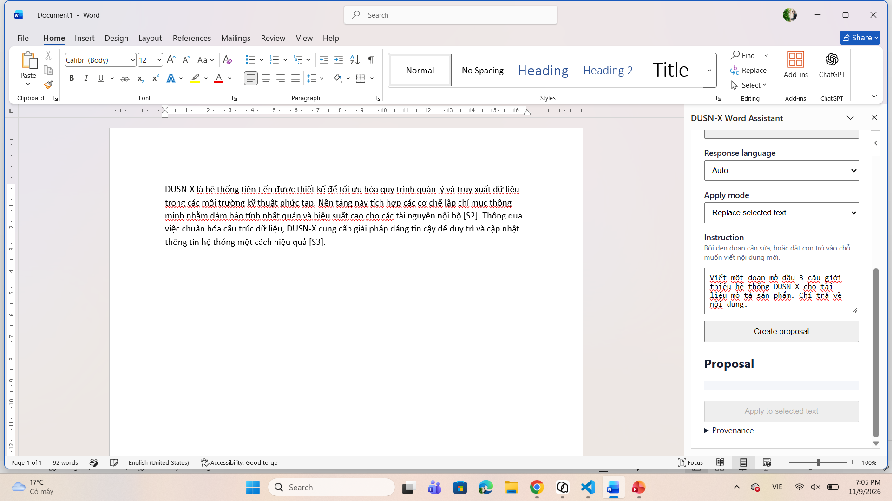

# Word Add-in Desktop evidence — 2026-11-09

Bằng chứng chạy **Word Desktop thật** với task pane Office.js sideload, Gateway local và
provider ngoài Gemini. Tài khoản là user tổng hợp `geminidesktop1`; tài liệu là file test tổng
hợp. Không có token, mật khẩu, cookie, dữ liệu người dùng thật hay secret nào trong thư mục này.

## Môi trường

| Thành phần | Giá trị |
|---|---|
| Ứng dụng | Microsoft Word, `16.0` build `16.0.20527`, platform `PC` |
| Task pane | `https://localhost:3001/word-taskpane.html` (Office tự thêm `_host_Info`) |
| Manifest | sideload theo user qua `HKCU\Software\Microsoft\Office\16.0\WEF\Developer`, GUID `fa2eca6f-d75f-4381-8c0a-d010bf31aba1` |
| HTTPS server | `word-addin/dev-server.js`: same-origin, CSP, `no-store`, proxy `/v1/*` về Gateway loopback |
| Gateway / AI API | `http://127.0.0.1:8080` / `http://127.0.0.1:8000` |
| Provider | Gemini qua endpoint OpenAI-compatible, model `gemini-3.1-flash-lite`, fallback `ollama` |

Số liệu gốc: [`real-word-evidence.json`](real-word-evidence.json).

## Kết quả

### 1. Proposal + provenance



Đăng nhập, tạo session `Word`, chọn đoạn 2 và bấm **Create proposal from selected text**.
Task pane hiện proposal và trạng thái `Review the proposal, then Apply to the selected text.`;
tài liệu chưa bị ghi. Provenance của một lượt proposal (chụp tại
[`word-desktop-provenance.png`](word-desktop-provenance.png)):

```json
{
  "intent": "followup",
  "routing_source": "model",
  "response_source": "llm",
  "provider_used": "openai",
  "model_used": "gemini-3.1-flash-lite"
}
```

### 2. Replace selected text



Apply mode **Replace selected text**: đoạn đang chọn được thay bằng proposal, proposal bị xóa,
nút Apply khóa lại. Đoạn tiêu đề và đoạn cuối
`Phan con lai cua tai lieu khong duoc gui len gateway.` vẫn còn.

### 3. Insert new paragraph after selection



Apply mode **Insert new paragraph after selection**: một đoạn mới được chèn sau đoạn đang chọn,
đoạn gốc vẫn nguyên. Kết quả cuối trong file:

| # | Đoạn |
|---|---|
| 1 | `Báo cáo tiến độ dự án DUSN-X` |
| 2 | `Tuần này, nhóm đã hoàn tất việc tích hợp RAG vào hệ thống chat và cập nhật giao diện người dùng theo thiết kế mới.` |
| 3 | `Tuần này, nhóm đã hoàn tất việc tích hợp RAG vào hệ thống chat và cập nhật giao diện người dùng theo thiết kế mới. Tiến độ công việc đang bám sát kế hoạch đề ra.` |
| 4 | *(đoạn trống phân cách do thao tác chèn)* |
| 5 | `Phan con lai cua tai lieu khong duoc gui len gateway.` |

File đã lưu và đọc lại bằng COM/Word: SHA-256
`2e8f468401ed08b4b7192b8c58f1b89b99a5acbce47d95e317fb803ccfd7e609`, 17.701 byte, 5 đoạn.
File `.docx` chỉ lưu local (artifact test), không commit vào repo.

### 4. Guard khi selection đổi





Tạo proposal trên đoạn đích, sau đó đổi selection sang đoạn khác rồi bấm Apply. Kết quả:

- Trạng thái: `Selection or text changed. Create and review a new proposal before Apply.`
- Proposal bị xóa, Apply bị khóa.
- Tài liệu không đổi (không có write).


### 5. Viết nội dung mới tại con trỏ (bổ sung 2026-11-09)



Tài liệu trắng (0 từ), không bôi đen gì — chỉ đặt con trỏ. Nhập instruction, bấm **Create proposal**:
pane sinh proposal từ Gemini, nút đổi thành **Insert at cursor**; sau khi bấm, Word có đoạn 92 từ.
Đây là bản sửa cho lỗi trước đó: pane từ chối mọi yêu cầu khi chưa bôi đen ("Select text in the
document first."), nên không thể tạo chữ trong tài liệu mới.

## Kiểm thử tự động đi kèm

- `word-addin/word-taskpane.test.js`: 19/19 pass (proposal/apply/guard/logout/race/abort/provenance).
- `word-addin/dev-server.test.js`: 7/7 pass (allowlist, Gateway URL, header, CSP, body limit).
- Các suite khác của repo được chạy lại ở lượt bàn giao (xem `docs/PROJECT_STATUS_20261107.md`).

## Ghi chú trung thực

- Bằng chứng này chứng minh **tích hợp, hai chế độ Apply, guard và provenance hoạt động trong
  Word thật**, không chứng minh chất lượng văn bản của model.
- Proposal cuối cùng (dùng để chụp provenance) **không được Apply**; model trả về văn bản có
  thêm ký hiệu Markdown `**...**`, cho thấy người dùng vẫn phải review trước khi ghi.
- Ảnh chụp từ cửa sổ Word thật ở 100% (màn hình 1920×1080, DPI 125%); không dùng mock hay ảnh
  dựng. Có lúc app khác chiếm foreground nên cửa sổ Word được khôi phục/maximize lại; không ảnh
  hưởng nội dung tài liệu.
- Không có secret trong thư mục này: mật khẩu tài khoản tổng hợp, token phiên và key provider
  đều không được ghi lại.
